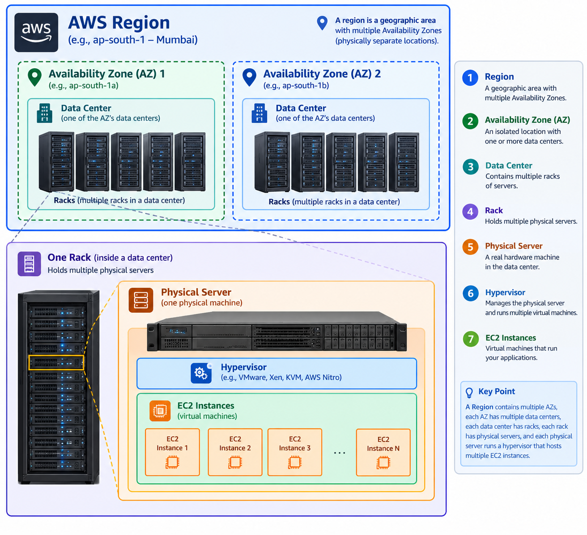

What is an IP address?

An IP address (Internet Protocol address) is a logical address used to identify a device on a network and route traffic to or from it.

For example, an EC2 instance in AWS might have these addresses:
Public IP
13.234.120.10 # Example address for communication over the internet.
Private IP
10.0.1.25 #Used for communication within a private network, such as an AWS VPC.

An IPv4 address contains 32 bits, represented as four decimal numbers called octets, each ranging from 0 to 255.

Example:

192.168.1.10

192 --> First
168 --> Second
1 --> Third
10 --> Fourth
Each octet represents 8 bits, so 8×4=32 bits in total.

In traditional IPv4 networking, addresses were divided into five classes: A, B, C, D, and E.

A
Class A
1.0.0.0 – 126.255.255.255
Default mask: 255.0.0.0 (/8)
Large networks. Traditional first-octet range is 1–126, excluding special-use ranges from ordinary host allocation.

B
Class B
128.0.0.0 – 191.255.255.255
Default mask: 255.255.0.0 (/16)
Medium-sized networks.

C
Class C
192.0.0.0 – 223.255.255.255
Default mask: 255.255.255.0 (/24)
Small networks.

D
Class D
224.0.0.0 – 239.255.255.255
Used for IPv4 multicast, not ordinary host addressing.

E
Class E
240.0.0.0 – 255.255.255.255
Reserved for special purposes and experimental use; 255.255.255.255 is the limited broadcast address.

Modern networks use CIDR notation, such as /16, /24, and /26, to decide network size.

# private IP

A private IP address is used inside private networks and is not directly routable over the public internet.

The three private IPv4 ranges you should memorize are:

CL A range 
10.0.0.0 – 10.255.255.255 --> 10.0.0.0/8
CL B range 
172.16.0.0 – 172.31.255.255 --> 172.16.0.0/12
CL C range 
192.168.0.0 – 192.168.255.255 --> 192.168.0.0/16

# public IP
A public IP address is globally routable, subject to network configuration and applicable restrictions.
Examples of public IPv4 addresses include 8.8.8.8 and 1.1.1.1.

In AWS, an EC2 instance generally needs all of the following for direct IPv4 internet connectivity:

A public IPv4 address or Elastic IP.
A route to an Internet Gateway through its subnet's route table.
Security group and network ACL rules that permit the traffic.
An application or service listening on the required port.

# What is a subnet

A subnet is a smaller IP network created from a larger network range.

For example, create this VPC:
10.0.0.0/16

Then divide it into subnets:

AWS VPC
10.0.0.0/16
65,536 total IPv4 addresses

Public subnet
10.0.1.0/24
256 total addresses
Example: web server
----

Private subnet
10.0.2.0/24
256 total addresses
Example: database

A subnet is not automatically public or private based on its IP range.
In AWS, its route table and connectivity configuration determine whether it functions as a public or private subnet.
1. A public subnet normally has a route such as 0.0.0.0/0 → Internet Gateway.
2. A private subnet normally has no direct route to an Internet Gateway. It may use a NAT Gateway for outbound IPv4 internet access.

# subnet mask

A subnet mask identifies which bits of an IP address belong to the network and which bits are available for host addresses.

For example:
IP address: 192.168.1.10
Subnet mask: 255.255.255.0
CIDR notation: /24
The mask 255.255.255.0 means the first 24 bits represent the network portion, and the remaining 8 bits represent the host portion.

/8 --> 255.0.0.0 --> 8(network bits) 24(Host bits)

/16 --> 255.255.0.0 --> 16(network bits) 16(Host bits)

/24 --> 255.255.255.0 --> 24(network bits) 8(Host bits)

/30 --> 255.255.255.252 --> 30(network bits) 2(Host bits)

The /24 in 192.168.1.0/24 tells you that 24 of the 32 bits are used for the network prefix.

This is one of the most important topics for networking interviews.

Use these two formulas:

Total IPv4 addresses=2^(32−prefix)
Traditional usable hosts=2^(32−prefix)−2

For example, calculate 192.168.1.0/24.
IPv4 contains 32 bits.
Network prefix is 24 bits.
Host bits = 32−24=8.
Total addresses = 2^8=256.
Traditional usable hosts = 256−2=254.

WS-specific rule: AWS reserves 5 IPv4 addresses per subnet

AWS reserves the first four IP addresses and the last IP address in each IPv4 subnet. Therefore, for ordinary AWS VPC subnets, subtract 5, rather than 2, to calculate assignable IPv4 addresses.
For example, an AWS subnet with a /24 prefix has:
Total IP addresses: 256
AWS-reserved addresses: 5
Remaining assignable addresses: 251
A /26 AWS subnet has 64−5=59 assignable IPv4 addresses.

# How to calculate subnet ranges

Let's use 192.168.1.0/26.
The prefix is /26, so:
Host bits = 32−26=6
Total IP addresses = 2^6=64
Subnet mask = 255.255.255.192
Traditional usable hosts = 62
AWS assignable addresses = 59

192.168.1.0/26(Network address) --> .0 – .63(range) --> .63(broadcast address)
192.168.1.64/26(Network address) --> .64 – .127(range) --> .127(broadcast address)
192.168.1.192/26(Network address) -->.192 – .255(range) --> .255(broadcast address)

Each subnet has 64 addresses. The network address and broadcast address are included in the range, not additional addresses.

# AWS Region and Availability Zones (AZs) --> 

In AWS, Region and Availability Zone (AZ) are important concepts for designing VPCs, EC2 instances, databases, and highly available applications.

Region: An AWS Region is a separate geographical area where AWS operates its cloud infrastructure.

Examples of AWS Regions:
Mumbai, India
Region code: ap-south-1
You have used this region in your AWS Kubernetes practice.

Northern Virginia, USA
Region code: us-east-1

Northern Virginia, USA
Region code: us-east-1

Each Region contains multiple Availability Zones. Regions are geographically separated from one another, which helps with disaster recovery and geographical distribution.

For example, when launching an EC2 instance, you select a Region such as ap-south-1.

Availability Zone (AZ) : An Availability Zone (AZ) is an isolated location within an AWS Region, made up of one or more data centers.
For example, the Mumbai Region has AZ identifiers such as:
ap-south-1a
ap-south-1b
ap-south-1c

The available AZs depend on the AWS account and service. Also, the letter a is not guaranteed to refer to the same physical AZ across different AWS accounts.

Imagine you run a website on one EC2 instance in ap-south-1a.
If that AZ experiences an outage, your website could become unavailable. If you deploy another instance in ap-south-1b and configure a load balancer and health checks, traffic can be served by the other instance when it is healthy and reachable.
This is called high availability.

